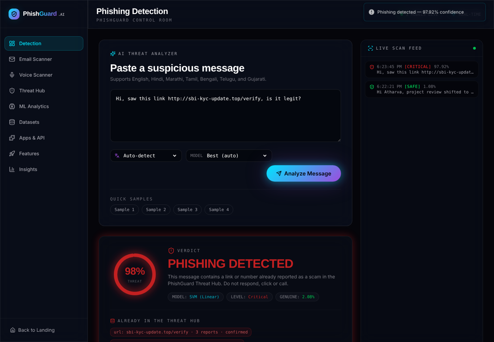
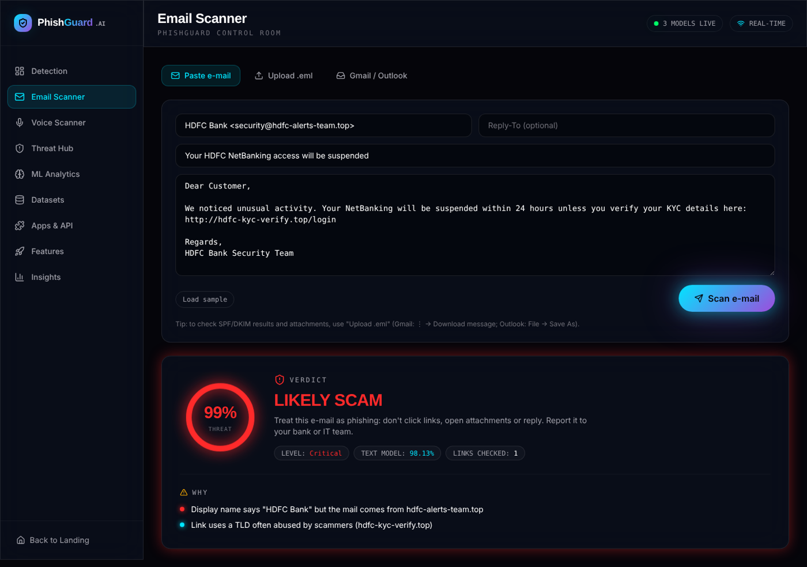
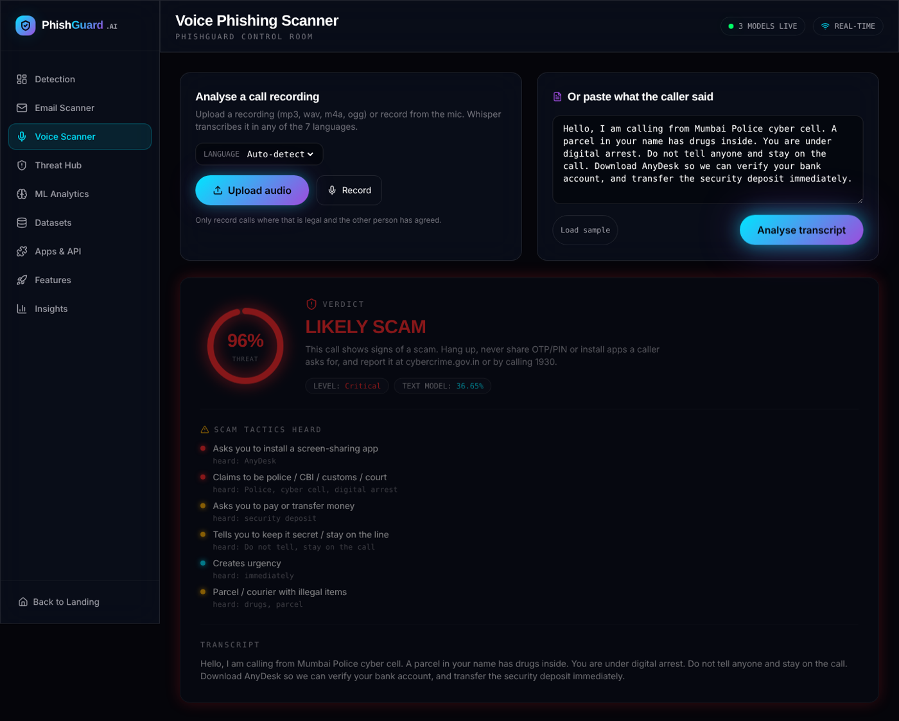
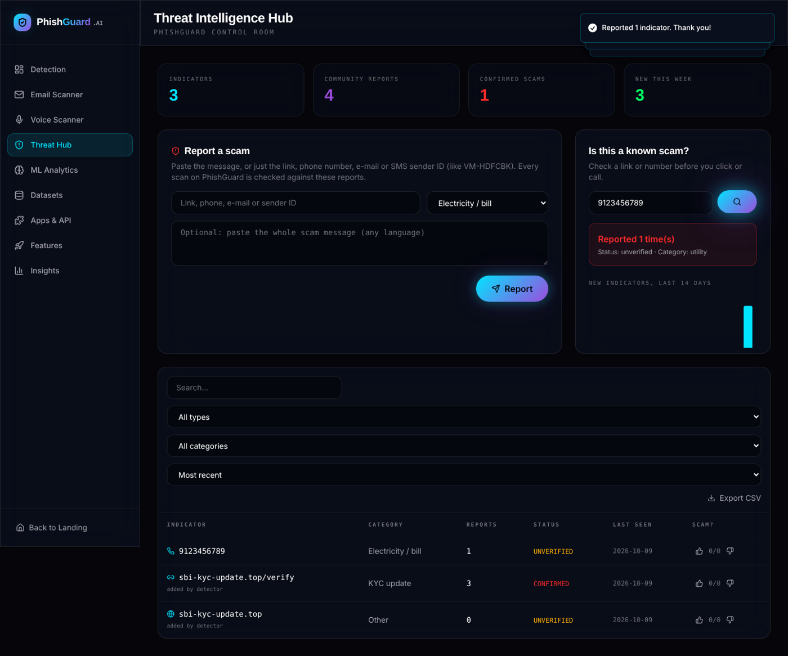
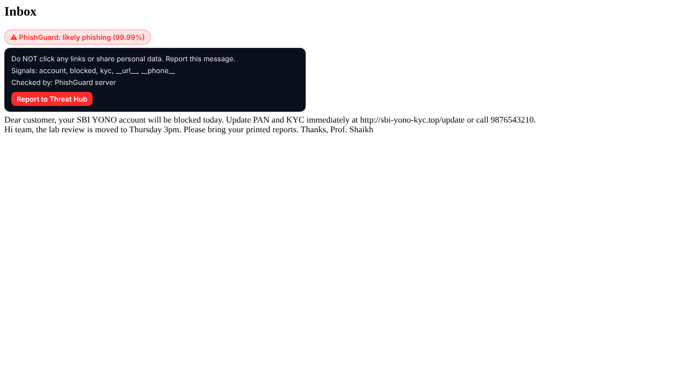
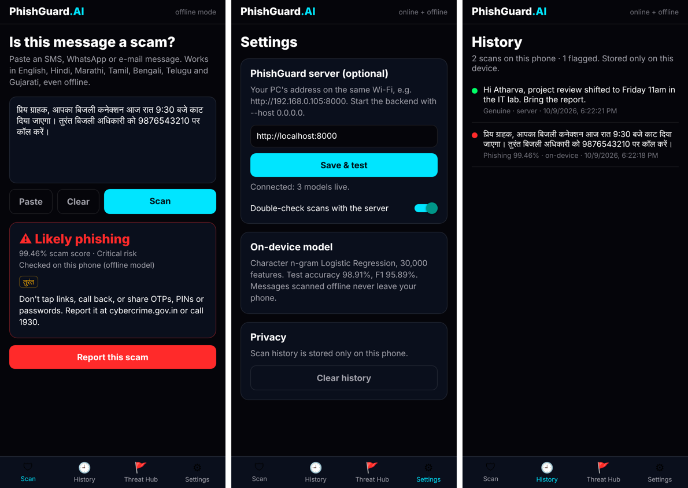

# PhishGuard.AI: Multilingual Phishing & Smishing Detection

Detects phishing in SMS, e-mail, chat and phone calls in **English, Hindi, Marathi, Tamil, Bengali, Telugu and Gujarati**.



| Part | Folder | What it does |
| --- | --- | --- |
| API | `backend/` | FastAPI + 3 ML models (LR, NB, calibrated Linear SVM), Threat Hub, e-mail and voice scanners |
| Dashboard | `frontend/` | React 19 web app |
| Browser extension | `extension/` | Chrome / Edge / Firefox: badges on Gmail, Outlook, Google Messages, WhatsApp Web |
| Mobile app | `mobile/` | Expo (Android / iOS) with an offline on-device model |
| Transformer training | `notebooks/`, `backend/ml/train_transformer.py` | Fine-tune XLM-RoBERTa / IndicBERT on Colab |
| Shared JS model | `shared/` | One JavaScript port of the on-device model used by the app and extension |

## Results (20% stratified hold-out, 4,224 messages)

| Model | Accuracy | Precision | Recall | F1 |
| --- | --- | --- | --- | --- |
| Linear SVM + Platt calibration (server) | 99.10% | 98.52% | 94.67% | 96.56% |
| Logistic Regression (server) | 98.98% | 97.79% | 94.49% | 96.12% |
| Multinomial Naive Bayes (server) | 98.46% | 94.78% | 93.61% | 94.19% |
| On-device char n-gram LR (app & extension, 0.75 MB) | 98.91% | 96.58% | 95.20% | 95.89% |
| Transformer (XLM-R) | train on Colab, then it appears here automatically | | | |

## Run it

```bash
# 1. backend
cd backend
pip install -r requirements.txt
cp .env.example .env                               # needs a running MongoDB
uvicorn server:app --reload --port 8000          # add --host 0.0.0.0 for the phone app

# 2. dashboard
cd frontend
cp .env.example .env                               # points the UI at http://localhost:8000
yarn install
yarn start                                         # http://localhost:3000
```

Optional extras:

| Feature | Enable with |
| --- | --- |
| Voice call scanning | `pip install -r backend/requirements-voice.txt` (first scan downloads the Whisper model) |
| Gmail / Outlook inbox scanning | OAuth keys in `backend/.env`, see [docs/EMAIL_SETUP.md](docs/EMAIL_SETUP.md) |
| Transformer model | [notebooks/train_transformer_colab.ipynb](notebooks/train_transformer_colab.ipynb) on a free Colab GPU |
| Browser extension | [extension/README.md](extension/README.md) |
| Mobile app | [mobile/README.md](mobile/README.md) |

## Features

* **Detection**: 3 models side by side, threat score, suspicious keywords, auto language detection.
* **Threat Intelligence Hub**: community reports of scam links, phone numbers, e-mails and SMS sender IDs. Every scan is checked against it; links in very confident phishing verdicts are added automatically; 3 reports = *confirmed*. Public JSON/CSV feed at `/api/threats/export`.
* **Email Scanner**: paste, upload `.eml`, or connect Gmail/Outlook. Adds header and link checks the SMS model can't see: display-name brand spoofing, Reply-To mismatch, SPF/DKIM/DMARC failures, link text ≠ real destination, IP/punycode/shortened links, risky attachments.
* **Voice Scanner**: Whisper speech-to-text in 7 languages, then the text model + vishing tactics (OTP/PIN requests, AnyDesk/TeamViewer, fake police/"digital arrest", secrecy, money transfer, parcel scams) + delivery features (speaking rate, longest monologue).
* **Browser extension** and **mobile app**, both working offline with the on-device model.

## Screenshots

| Email scanner | Voice scanner |
| --- | --- |
|  |  |
| **Threat Intelligence Hub** | **Browser extension on Gmail** |
|  |  |



## Retraining

```bash
cd backend
python -m ml.train                 # LR / NB / SVM  -> ml/models/
python -m ml.export_on_device      # on-device model -> ml/models/on_device.json
cd .. && node shared/parity-check.js   # JS port == scikit-learn (400/400, identical cleaning)
cd mobile && npm run sync-model && cp ../backend/ml/models/on_device.json ../extension/models/
```

## Tests

```bash
cd backend
pip install -r requirements-dev.txt
pytest tests/test_features.py -q   # 20 tests, in-memory MongoDB, no server needed
```

## Team

Final-year project, Department of Information Technology.

* Atharva Kshirsagar
* Niloy Mondal
* Adarsh Pradeep
* Ayush Palande

Guide: Prof. Bushra Shaikh
